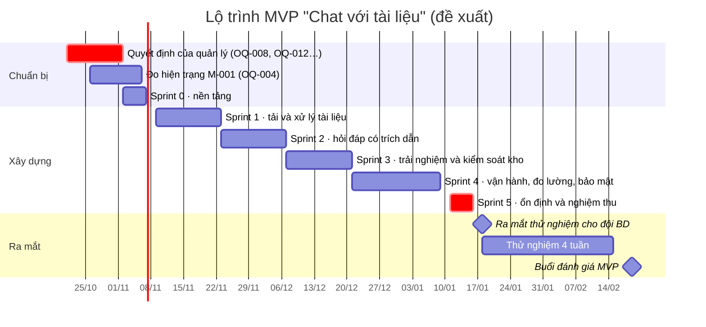

# Implementation Plan — Chat với tài liệu (MVP)

| Thuộc tính | Giá trị |
|---|---|
| Tài liệu | IMPL-001 |
| Phiên bản | 0.1 · Draft |
| Ngày | 2026-10-21 |
| Đầu vào | [userStory.md](userStory.md) (34 story, 150 điểm), [SAD v0.1](../03-design/SAD.md), [Blueprint v1.1](../04-design/Blueprint_SDD.md), [PRD v0.2 §5](../02-requirements/PRD.md) (điều kiện ra mắt LG-01 → LG-17) |
| Người đọc | Tech lead, đội phát triển, QA, DevOps, PO / BA, quản lý |

> **Lưu ý:** ngân sách, thời gian và quy mô đội chưa được quyết định (OQ-012). Đội ngũ, năng lực sprint và lịch dưới đây là **phương án đề xuất** `[Đề xuất]` để quản lý chốt. Nếu thay đổi, chỉ cần tính lại Mục 3 theo năng lực mới; thứ tự ưu tiên ở Mục 4 giữ nguyên.

---

## 1. Mục tiêu và tiêu chí hoàn thành

**Mục tiêu:** đưa MVP vào dùng thử với đội BD, đạt **toàn bộ 17 điều kiện ra mắt** (PRD §5.1). Sau đó chạy **4 tuần thử nghiệm** để đo M-001, M-002, M-003 và quyết định mở rộng, điều chỉnh hay dừng (OQ-022).

| Mốc | Định nghĩa "xong" |
|---|---|
| **MVP sẵn sàng ra mắt** | 8 story P0 + 10 story P1 + 12 enabler xong theo DoD; LG-01 → LG-17 đạt; IT / Bảo mật ký phê duyệt (LG-09, LG-12) |
| **Thử nghiệm xong** | 4 tuần sử dụng; có số liệu KR1.1, KR2.1 → KR2.3, KR3.1, KR3.2; buổi đánh giá với quản lý |
| P2 (US-206, US-308, US-311, US-402) | Làm nếu còn năng lực ở Sprint 4; không chặn ra mắt (CON-004) |

---

## 2. Đội ngũ và cách làm việc `[Đề xuất]`

| Vai trò | Thời lượng | Trách nhiệm chính |
|---|---|---|
| Tech lead / Backend | 100% | Kiến trúc, API, bảo mật, review code, chịu trách nhiệm LG kỹ thuật |
| Backend / AI engineer | 100% | Pipeline xử lý, embedder, truy xuất, LLM adapter, đánh giá chất lượng |
| Frontend engineer | 100% | SPA, design system, vùng nguồn PDF, streaming |
| QA engineer | 50% | Test plan, E2E, test hiệu năng, kiểm tra LG |
| DevOps | 25% | Hạ tầng, CI/CD, giám sát, sao lưu |
| Designer | 25% (Sprint 0 → 3) | Hoàn thiện UI theo prototype, kiểm tra khả năng tiếp cận |
| PO / BA | 50% | Backlog, ưu tiên, nghiệm thu story, cầu nối với đội BD |
| Trưởng nhóm BD | Theo đợt | Bộ câu hỏi kiểm thử (DEP-003), chấm nghiệm thu, đo hiện trạng (OQ-004) |

**Năng lực ước tính:** 3 kỹ sư toàn thời gian ≈ **30 điểm / sprint 2 tuần** (sau khi trừ họp, review, sửa lỗi). Cần hiệu chỉnh lại sau Sprint 1.

**Cách làm việc**
- Sprint 2 tuần; planning đầu sprint; demo + retro cuối sprint; daily 15 phút.
- **Trunk-based:** nhánh ngắn ngày, pull request cần 1 người review; `main` luôn deploy được lên staging.
- Mỗi pull request phải qua CI: lint, kiểm tra quy tắc import (DR-1 → DR-5), unit test, integration test, kiểm tra không có nội dung trong log.
- **Feature flag** cho các story P1/P2, để bật dần trên staging mà không chặn release.

---

## 3. Lộ trình `[Đề xuất]`

Giả định bắt đầu ngay sau khi các quyết định ở Mục 5 được đưa ra (hạn 02/11/2026).



| Sprint | Thời gian | Mục tiêu | Story | Điểm |
|---|---|---|---|---|
| **Sprint 0** | 02/11 → 06/11 (1 tuần) | Nền tảng chạy được, giảm rủi ro kỹ thuật lớn nhất | EN-01, EN-02 (phần dev, 3 điểm), EN-03 (benchmark, **TQ-02**), EN-11 | 16 |
| **Sprint 1** | 09/11 → 20/11 | Đăng nhập; tải file và có trạng thái "Sẵn sàng" | US-101, US-102, US-201, US-202, EN-02 (staging, 5 điểm), EN-04 | 29 |
| **Sprint 2** | 23/11 → 04/12 | Câu trả lời đầu tiên có trích dẫn; lần chạy đánh giá đầu tiên | EN-05, EN-06, US-301, US-302, US-303, US-304, EN-10 | 37 |
| **Sprint 3** | 07/12 → 18/12 | Trải nghiệm đầy đủ: mở nguồn, hiện dần, dừng, gỡ tài liệu | US-305, US-306, US-310, US-203, US-204, US-205, US-307, US-309, EN-08 | 31 |
| **Sprint 4** | 21/12 → 08/01 (3 tuần, có nghỉ lễ) | Vận hành, đo lường, bảo mật; story P2 nếu còn năng lực | US-103, US-401, EN-07, EN-09, EN-12 · *P2: US-206, US-308, US-311, US-402* | 22 (+15) |
| **Sprint 5** | 11/01 → 15/01 (1 tuần) | Chạy đủ LG-01 → LG-17, sửa lỗi, UAT với Trưởng nhóm BD | Sửa lỗi; không nhận story mới | — |
| **Thử nghiệm** | 18/01 → 12/02/2027 | Đội BD dùng thật; theo dõi số liệu hằng tuần | — | — |

Sprint 2 có 37 điểm, vượt năng lực ước tính. Nếu Sprint 1 cho thấy năng lực thấp hơn 30 điểm, chuyển EN-10 sang đầu Sprint 3. EN-10 chỉ cần xong trước lần chạy đánh giá cuối Sprint 3.

**Rủi ro lịch:**
- Sprint 4 trùng kỳ nghỉ cuối năm, nên được tính 3 tuần.
- 4 tuần thử nghiệm có thể trùng Tết Nguyên Đán 2027 (khoảng đầu tháng 2, cần kiểm tra lịch). Tuần nghỉ Tết sẽ làm sai lệch M-003. Đề xuất: không tính tuần Tết vào cửa sổ đo, hoặc kéo dài thử nghiệm thêm 1 tuần (Mục 9).

---

## 4. Nội dung từng sprint

### Sprint 0 — Nền tảng (1 tuần)
**Mục tiêu:** mọi kỹ sư chạy được hệ thống ở máy dev; trả lời được câu hỏi "embedder trên CPU có đủ nhanh không".

| Việc | Kết quả |
|---|---|
| EN-01: repo theo Blueprint §3.1 | Cấu trúc thư mục (Mục 6), CI với lint, import-linter, khung test |
| EN-02 (phần dev): `docker compose` | PostgreSQL + pgvector, MinIO, embedder, api, worker chạy được ở máy dev |
| EN-03: benchmark embedder | Báo cáo: thời gian lập chỉ mục file 300 trang, độ trễ truy vấn. Quyết định CPU / GPU / số bản sao |
| EN-11 | `tokens.css` → theme React; toàn bộ component của design-system.html (các màn hình ở sprint sau dùng lại) |
| Không phải code | Gửi yêu cầu bộ câu hỏi kiểm thử (DEP-003); bắt đầu đo M-001 (OQ-004); IT xác nhận IdP và nhóm (DEP-002) |

**Điều kiện kết thúc:** CI xanh trên `main`; có báo cáo benchmark; đã có 1 tài khoản thử trên IdP.

### Sprint 1 — Tải và xử lý tài liệu
**Mục tiêu sprint:** *"Thành viên BD đăng nhập, tải PDF lên và thấy tài liệu Sẵn sàng."*

| Story | Ghi chú kỹ thuật |
|---|---|
| US-101, US-102 | BFF OIDC + PKCE; cookie `__Host-session`; ánh xạ nhóm → vai trò; audit log cơ bản |
| US-201 | Upload multipart có tiến độ; kiểm tra magic bytes; SHA-256; lưu MinIO / S3; tạo `document` + `job` trong cùng một giao dịch |
| US-202 | Hỏi lại trạng thái mỗi 3 giây khi còn file đang xử lý |
| EN-04 | Worker, `SKIP LOCKED`, `LISTEN/NOTIFY`; PyMuPDF; ALG-1; thử lại 3 lần |
| EN-02 (staging) | Môi trường staging qua HTTPS, secrets manager |

**Demo:** đăng nhập trên staging, tải 5 file (có 1 file scan, 1 file có mật khẩu), xem đủ các trạng thái.
**Kiểm tra LG sớm:** LG-07 (file 50 MB ≤ 5 phút), LG-10 (truy cập trái phép).

### Sprint 2 — Hỏi đáp có trích dẫn
**Mục tiêu sprint:** *"Thành viên BD hỏi và nhận câu trả lời có trích dẫn tài liệu và trang, hoặc 'không tìm thấy'."*

| Story | Ghi chú kỹ thuật |
|---|---|
| EN-05 | Truy vấn vector + FTS song song, RRF, `τ` trong cấu hình |
| EN-06 | Adapter LLM theo kết quả OQ-008; fake adapter cho test; timeout và circuit breaker |
| US-301 → US-304 | SSE (`meta`, `delta`, `citations`, `done`, `error`); CitationPolicy (ALG-3) |
| EN-10 | Nạp bộ tài liệu mẫu và câu hỏi; job đánh giá ban đêm báo KR2.1 → KR2.3 |

**Demo:** hỏi 5 câu (gồm 1 câu cần 2 tài liệu, 1 câu không có đáp án).
**Kiểm tra LG sớm:** lần chạy đánh giá đầu tiên cho LG-03 → LG-05. Chưa cần đạt ngưỡng, nhưng phải có số liệu để biết khoảng cách.

**Phương án dự phòng nếu OQ-008 chưa có lời giải khi bắt đầu Sprint 2:** dùng fake adapter và một mô hình open-weight chạy nội bộ trên staging để không chặn việc phát triển. Adapter thật được hoàn thiện khi có quyết định, nhờ port `AnswerGenerator` không đổi.

### Sprint 3 — Trải nghiệm và kiểm soát kho
**Mục tiêu sprint:** *"Kiểm chứng một trích dẫn bằng một lần bấm; tự quản lý tài liệu của mình."*

| Story | Ghi chú kỹ thuật |
|---|---|
| US-305 | PDF.js tải lazy; endpoint file có HTTP Range; tô sáng theo `excerpt` |
| US-306, US-310 | Hiển thị dần; thay nội dung khi `done NOT_FOUND` (TQ-01); huỷ lời gọi LLM qua cờ trong tiến trình + `NOTIFY` |
| US-203, US-204, US-205 | Lọc trigram; quyền gỡ (PD-02) ở `PermissionPolicy`; job purge |
| US-307, US-309 | Clipboard; phản hồi + lý do |
| EN-08 | Bảng sự kiện, danh sách thuộc tính cho phép, HMAC |

**Kiểm tra LG sớm:** LG-05 (trích dẫn đúng trang), NFR-05 (mở nguồn ≤ 2 giây).

### Sprint 4 — Vận hành, đo lường, bảo mật
**Mục tiêu sprint:** *"Hệ thống vận hành được, đo được, và qua được rà soát bảo mật."*

| Story | Ghi chú kỹ thuật |
|---|---|
| EN-07 | OTel (8 span), Prometheus, Loki, 9 cảnh báo; probe ngoài trong giờ làm việc |
| EN-09 | CSP, CSRF, giới hạn tần suất, quét lỗ hổng, audit log đầy đủ, mã hoá khi lưu đã bật |
| EN-12 | E2E F1 → F6 (Playwright), test 100 câu hỏi cho p95, axe |
| US-103, US-401 | Hết phiên sau 8 giờ; trang số liệu từ `daily_rollup` |
| *P2 nếu còn năng lực* | US-206, US-308, US-311, US-402 — sau feature flag |

**Gửi IT / Bảo mật:** hồ sơ để phê duyệt LG-09, LG-11, LG-12 (kiến trúc, luồng dữ liệu tới LLM, điều khoản nhà cung cấp, kết quả quét lỗ hổng).

### Sprint 5 — Ổn định và nghiệm thu
- Chạy checklist LG-01 → LG-17 (Mục 7.2), sửa lỗi, không nhận story mới.
- Trưởng nhóm BD chấm bộ câu hỏi kiểm thử (LG-03, LG-04).
- Diễn tập khôi phục từ bản sao lưu (REL-02, REL-03).
- Họp **Go / No-go** với quản lý, IT / Bảo mật, Trưởng nhóm BD.

---

## 5. Quyết định cần có và hạn chót

| Quyết định | Cần trước | Ảnh hưởng nếu trễ | Phương án dự phòng |
|---|---|---|---|
| **OQ-012** ngân sách, thời gian, đội ngũ | Sprint 0 | Không bắt đầu được | — |
| **OQ-002 / OQ-003** nhà tài trợ, người phê duyệt | Sprint 0 | Không ai nghiệm thu story và tài liệu | PO tạm nghiệm thu, quản lý xác nhận sau |
| **DEP-002** IdP và nhóm người dùng | Sprint 1 | US-101, US-102 bị chặn | Dùng IdP thử (Keycloak) trên dev / staging |
| **OQ-008** LLM đám mây hay nội bộ | Sprint 2 | EN-06, US-302 bị chặn; nếu phải chạy nội bộ: +1 sprint và cần mua GPU (AR-01) | Mô hình open-weight trên staging (Mục 4, Sprint 2) |
| **OQ-014** ngôn ngữ câu hỏi và tài liệu | Sprint 2 | Thiết kế bộ câu hỏi kiểm thử | Tạm tiếng Việt + tiếng Anh |
| **DEP-003** bộ câu hỏi kiểm thử | Sprint 2 | Không đo được LG-03 → LG-05 | BA soạn bộ tạm 20 câu |
| **PQ-001 / PQ-002** kho chung; quyền gỡ | Sprint 3 | US-204 | Theo PD-01, PD-02 |
| **TQ-01** hiện dần rồi thay bằng "không tìm thấy" | Sprint 3 | US-306 | Theo thiết kế hiện tại; đo tần suất bị thay khi thử nghiệm |
| **PQ-006** BR-009 thành bắt buộc | Sprint 4 | LG-06 có còn là điều kiện ra mắt không | Giữ LG-06 là điều kiện ra mắt |
| **OQ-016, OQ-021** thời gian lưu giữ; dữ liệu cá nhân | Sprint 4 | EN-09, phê duyệt bảo mật | Dùng giá trị `[Đề xuất]` của SAD §2.3 |
| **OQ-004** đo hiện trạng M-001 | Trước ra mắt (LG-16) | Không chứng minh được lợi ích | Khảo sát tự khai, gắn nhãn `[Unverified]` |

---

## 6. Cấu trúc mã nguồn và môi trường

```text
chat-voi-tai-lieu/
├── web/                         # SPA React + TypeScript (Vite)
│   └── src/{app-shell, library, chat, source-viewer, metrics, ui, state, api-client}
├── backend/
│   ├── domain/                  # thực thể, CitationPolicy, PermissionPolicy, UploadPolicy — không import framework
│   ├── application/             # AccessService, DocumentService, DocumentProcessingService,
│   │                            # QuestionAnsweringService, EvaluationService, MetricsService
│   ├── ports/                   # IdentityProvider, DocumentStorage, AnswerGenerator, EmbeddingProvider, ChunkIndex, AnalyticsSink
│   ├── adapters/{http, jobs, oidc, storage, llm, embedder, pgvector, analytics, db}
│   ├── platform/                # cấu hình, logging có lọc nội dung, OTel, circuit breaker, rate limiter
│   └── migrations/              # Alembic, theo mẫu expand / contract
├── eval/                        # bộ câu hỏi kiểm thử, script đánh giá (EN-10)
├── e2e/                         # Playwright (EN-12)
├── infra/                       # docker-compose (dev), IaC staging / prod (Terraform hoặc Ansible)
└── docs/                        # tài liệu hiện có
```

| Môi trường | Mục đích | Dữ liệu | Triển khai |
|---|---|---|---|
| **dev** | Máy kỹ sư | Tài liệu mẫu, fake LLM | `docker compose up` |
| **staging** | Demo, E2E, test hiệu năng, UAT | Bộ tài liệu mẫu (DEP-003), LLM thật hoặc open-weight | Tự động khi merge vào `main` |
| **prod** | Thử nghiệm với đội BD | Tài liệu thật của đội BD | Thủ công, sau Go / No-go; rolling update |

**Pipeline CI/CD:** lint → kiểm tra import → unit test → integration test (PostgreSQL thật trong container) → contract test SSE → build image → quét lỗ hổng → deploy staging → E2E smoke. Đánh giá chất lượng (EN-10) và test hiệu năng chạy ban đêm trên staging.

---

## 7. Kiểm thử và kiểm soát chất lượng

### 7.1 Chiến lược kiểm thử

| Mức | Phạm vi | Công cụ | Ngưỡng |
|---|---|---|---|
| Unit | domain, application (với fake adapter) | pytest, Vitest | Coverage ≥ 80% domain + application (QAS-09) |
| Integration | Repository, ChunkIndex, job queue, OIDC | pytest + PostgreSQL / MinIO trong container | Chạy ≤ 5 phút |
| Contract | Sự kiện SSE, mã lỗi RFC 9457 | pytest + schema | 100% sự kiện của SAD §2.4 |
| Chất lượng câu trả lời | Bộ câu hỏi kiểm thử | EN-10 | KR2.1 ≥ 80%, KR2.2 ≥ 9/10, KR2.3 ≥ 90% |
| E2E | Luồng F1 → F6 | Playwright | Mọi AC P0 |
| Hiệu năng | 100 câu hỏi, 10 đồng thời | k6 hoặc Locust | p95 ≤ 30 s; phần đầu ≤ 5 s; lỗi ≤ 2% |
| Bảo mật | Truy cập trái phép, quét lỗ hổng, rò rỉ nội dung vào log | Bộ test riêng, Trivy / pip-audit / npm audit | 100% bị từ chối; 0 Critical / High |
| Khả năng tiếp cận | Mọi màn hình | axe-core, kiểm tra bàn phím thủ công | 0 lỗi serious / critical |

### 7.2 Điều kiện ra mắt → sprint kiểm tra lần đầu

| LG | Nội dung | Story | Kiểm tra lần đầu | Người xác nhận |
|---|---|---|---|---|
| LG-01 | Mọi AC của 8 story P0 đạt | US-101 → 304 | Sprint 2 | QA |
| LG-02 | 0 lỗi Critical / High đang mở | — | Sprint 5 | QA |
| LG-03 | Đúng và đủ ≥ 80% | US-302, EN-10 | Sprint 2 (đo), Sprint 5 (chấm) | Trưởng nhóm BD |
| LG-04 | "Không tìm thấy" ≥ 9/10 | US-304 | Sprint 2 | Trưởng nhóm BD |
| LG-05 | Trích dẫn đúng trang ≥ 90% | US-303 | Sprint 3 | QA |
| LG-06 | p95 trả lời ≤ 30 s | EN-06, EN-12 | Sprint 4 | QA |
| LG-07 | File 50 MB ≤ 5 phút | EN-04 | Sprint 1 | QA |
| LG-08 | Mở màn hình chính ≤ 3 s | EN-11 | Sprint 4 | QA |
| LG-09 | IT phê duyệt xử lý tài liệu bằng dịch vụ AI | EN-06 | Sprint 4 | IT / Bảo mật |
| LG-10 | 100% truy cập trái phép bị từ chối | US-102 | Sprint 1 | QA |
| LG-11 | Mã hoá; 0 lỗ hổng Critical / High | EN-09 | Sprint 4 | IT / Bảo mật |
| LG-12 | Cam kết không huấn luyện bằng văn bản | — (hợp đồng) | Sprint 4 | IT / Bảo mật |
| LG-13 | 100% AC P0 / P1 có test case | — | Sprint 4 | QA |
| LG-14 | Hồi quy trên trình duyệt chuẩn | EN-12 | Sprint 5 | QA |
| LG-15 | Mọi sự kiện PRD §5.2 được ghi | EN-08 | Sprint 3 | Engineering |
| LG-16 | Đã đo hiện trạng M-001 | — (OQ-004) | Trước Sprint 5 | Trưởng nhóm BD |
| LG-17 | Cảnh báo gián đoạn trong giờ làm việc | EN-07 | Sprint 4 | Engineering |

---

## 8. Rủi ro triển khai

| ID | Rủi ro | Dấu hiệu sớm | Ứng phó | Chủ |
|---|---|---|---|---|
| IR-01 | OQ-008 kết luận phải chạy AI nội bộ (AR-01) | Chưa có quyết định ở cuối Sprint 0 | Phát triển trên fake / open-weight; lập kế hoạch mua GPU; +1 sprint | Quản lý, Tech lead |
| IR-02 | Embedder trên CPU không đạt NFR-03 (TQ-02) | Benchmark Sprint 0 | Thêm bản sao, lô lớn hơn, hoặc dùng GPU | Backend / AI |
| IR-03 | Chất lượng câu trả lời dưới ngưỡng LG-03 / LG-05 | Lần đo đầu ở Sprint 2 | Hiệu chỉnh `τ`, top-k, kích thước đoạn, prompt; đo lại mỗi đêm | Backend / AI |
| IR-04 | Tìm kiếm toàn văn tiếng Việt kém (AR-02) | Câu hỏi có tên riêng bị trượt trong bộ kiểm thử | Tăng trọng số vector; cân nhắc bộ tách từ tiếng Việt ở giai đoạn sau | Backend / AI |
| IR-05 | Thiếu bộ câu hỏi kiểm thử (DEP-003) | Chưa nhận được ở đầu Sprint 2 | BA soạn bộ tạm 20 câu | PO / BA |
| IR-06 | Phạm vi phình to (R-002) | Story mới chen vào giữa sprint | Chỉ nhận qua PO; P2 sau feature flag | PO |
| IR-07 | Kỳ nghỉ cuối năm và Tết | Năng lực Sprint 4 thấp | Sprint 4 kéo dài 3 tuần; không tính tuần Tết khi đo M-003 | Tech lead, PO |
| IR-08 | Chi phí AI vượt dự kiến (R-006) | `llm_tokens_total` tăng mạnh trên staging | Giới hạn top-k và `max_tokens`; cảnh báo 150% | Tech lead |

---

## 9. Ra mắt và thử nghiệm

1. **Go / No-go (cuối Sprint 5):** đủ 17 LG, có phê duyệt của IT / Bảo mật, đã đo M-001.
2. **Ra mắt theo đợt:**
   - Tuần 1: 5 thành viên BD (gồm Trưởng nhóm).
   - Tuần 2: toàn đội (30 tài khoản).
   - Có thể tắt nhanh qua feature flag hoặc rút quyền trên IdP.
3. **Hỗ trợ:**
   - Hướng dẫn sử dụng 1 trang.
   - Buổi giới thiệu 30 phút.
   - Kênh chat hỗ trợ.
   - Trưởng nhóm BD là đầu mối nhận phản hồi.
4. **Theo dõi hằng tuần:**
   - Trang số liệu (US-401): M-003, KR3.2, p95, tỉ lệ "không tìm thấy", tỉ lệ lỗi.
   - Số lần câu trả lời bị thay bằng "không tìm thấy" (TQ-01).
5. **Buổi đánh giá MVP (sau 4 tuần dùng thực tế, không tính tuần Tết):**
   - Dữ liệu: M-001 (đo lại bằng 20 câu hỏi điển hình), M-002 (bộ câu hỏi kiểm thử), M-003, KR3.2.
   - Quyết định: mở rộng, điều chỉnh hoặc dừng (OQ-022).

---

## 10. Truy vết

| Tài liệu | Dùng ở kế hoạch này |
|---|---|
| [userStory.md](userStory.md) | Mục 3, 4: phân bổ story và điểm |
| [dev_tasks.md](dev_tasks.md) | Hợp đồng chung (CSDL, API, SSE, mã lỗi, sự kiện, prompt) và task con của từng story |
| [task/](task/README.md) | 37 file task sẵn sàng phát triển (34 story / enabler + 3 task phát hành Sprint 5) |
| PRD §5.1, §5.2 | Mục 7.2: điều kiện ra mắt; Mục 9: số liệu thử nghiệm |
| SAD ADR-01 → ADR-12, §2–§4 | Mục 4, 6: ghi chú kỹ thuật, cấu trúc, môi trường |
| Blueprint §3.1, §3.3, §3.9 | Mục 6: cấu trúc mã nguồn; quy tắc import; thuật toán |
| BRD §10, §12 | Mục 5, 8: quyết định mở và rủi ro |
